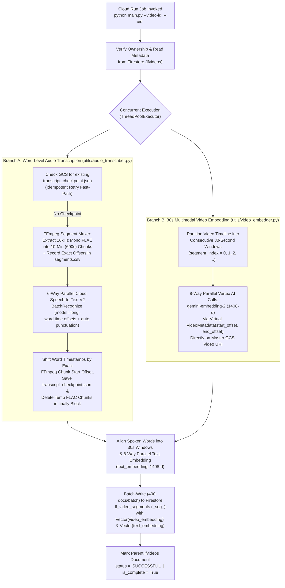

# CLIP_AGENT_OS — Asynchronous Video Processor Job (`capstone_video_processor`)

`capstone_video_processor` is the containerized **Google Cloud Run Job** responsible for asynchronous long-form video ingestion, word-level audio transcription, and parallel 30-second multimodal vector indexing for **CLIP_AGENT_OS**.

Whenever a user finishes uploading a raw long-form video to Google Cloud Storage (`POST /api/lf_videos/upload/{vid}/complete`), the FastAPI backend (`capstone_be`) dispatches an isolated execution of this Cloud Run Job (`--video-id <vid> --uid <uid>`), ensuring heavy media processing and embedding generation never block API or WebSocket chat responsiveness.

---

## 1. Parallel Processing Pipeline Architecture

When invoked with `--video-id <vid>` and `--uid <uid>`, `main.py` validates ownership against Firestore (`lfvideos`) and executes **two concurrent pipelines** using `ThreadPoolExecutor(max_workers=2)`:



### Key Architectural Optimizations
- **Zero Physical Video Slicing**: Rather than cutting a multi-gigabyte video into dozens of 30-second MP4 files and re-uploading them to GCS, `utils/video_embedder.py` passes `types.VideoMetadata(start_offset=..., end_offset=...)` directly against the master GCS URI (`gs://<GCS_ROOT_BUCKET_NAME>/<uid>/lf_videos/<video_id>/...`), generating `1408`-dimensional `video_embedding` vectors with **8 parallel workers** (`MAX_EMBED_WORKERS = 8`).
- **Frame-Accurate Multi-Hour Audio Chunking**: `utils/audio_transcriber.py` uses FFmpeg's `segment` muxer (`-ac 1 -ar 16000 -f segment -segment_time 600 -segment_list segments.csv`) to split multi-hour streams into 10-minute `16kHz` mono FLAC chunks, transcribes up to **6 chunks in parallel** via Cloud Speech-to-Text V2 (`BatchRecognize`, `model="long"`), and shifts every word's nanosecond protobuf offset by the exact `chunk_start_sec` recorded in `segments.csv`.
- **Idempotent Checkpointing & Guaranteed Cleanup**: Saves `transcript_checkpoint.json` to GCS immediately after Speech-to-Text finishes so job retries skip audio transcription, and deletes all temporary FLAC chunks in a `finally` block.
- **Batched Firestore Vector Indexing**: Wraps `1408`-dimensional `video_embedding` and `text_embedding` arrays in `google.cloud.firestore_v1.vector.Vector` objects and commits them to `lf_video_segments` in batches of `400` documents. If any step raises an unhandled exception, the parent `lfvideos` document is automatically marked `status = "FAILED"` with the error message.

---

## 2. Directory Structure

```text
capstone_video_processor/
├── main.py                      # CLI entrypoint (--video-id, --uid), parallel orchestrator & Firestore batch writer
├── Dockerfile                   # Python 3.14-slim container definition for Cloud Run Jobs
├── requirements.txt             # Pinned Python dependencies (Firestore, Storage, Speech V2, GenAI, imageio-ffmpeg)
└── utils/
    ├── audio_transcriber.py     # FFmpeg 16kHz FLAC 10-min chunker & 6-way parallel Speech-to-Text V2 client
    ├── video_embedder.py        # 8-way parallel 30s video & text embedding pipeline (gemini-embedding-2, 1408d)
    ├── db.py                    # Firestore Native client initialization
    └── storage.py               # Google Cloud Storage client initialization
```

---

## 3. Prerequisites & Environment Configuration

### Prerequisites
- **Python `3.14+`**.
- **Google Cloud SDK (`gcloud`)** authenticated against your target GCP sandbox project.
- *(Note: `imageio-ffmpeg` automatically provides a self-contained `ffmpeg` binary inside the Python environment, so no host OS FFmpeg installation is required).*

### Environment Variables (`.env`)
Create a `.env` file in `capstone_video_processor/` with the following configuration variables (replace angle-bracket placeholders with your environment's values):

```ini
# Google Cloud Project & Region
GCP_PROJECT_ID="<YOUR_GCP_PROJECT_ID>"
GCP_REGION="<YOUR_GCP_REGION>"

# Firestore Native Database & Collection Names
FIRESTORE_DB_NAME="<YOUR_FIRESTORE_DB_NAME>"
LFVIDEO_COLLECTION_NAME="lfvideos"
LFVIDEO_SEGMENT_COLLECTION_NAME="lf_video_segments"

# Google Cloud Storage Bucket
GCS_ROOT_BUCKET_NAME="<YOUR_GCS_BUCKET_NAME>"

# Multimodal Embedding Model & API Key
EMBEDDING_MODEL_NAME="gemini-embedding-2"
GEMINI_API_KEY="<YOUR_GEMINI_API_KEY>"
```

---

## 4. Running Locally

You can execute the processor directly from your terminal against any uploaded `LFVideo` document in your sandbox project:

### Step 1: Authenticate via Keyless Service Account Impersonation (ADC)
```bash
gcloud auth application-default login \
  --impersonate-service-account="<YOUR_BACKEND_SERVICE_ACCOUNT_EMAIL>"
```

### Step 2: Install Dependencies & Run the Processor CLI
```bash
cd capstone_video_processor

# Create a virtual environment and install dependencies
python3 -m venv .venv
source .venv/bin/activate
pip install -r requirements.txt

# Execute the indexing pipeline for a specific video document and owner UID
python main.py --video-id "<LFVIDEO_DOCUMENT_ID>" --uid "<OWNER_FIREBASE_UID>"
```

---

## 5. Cloud Deployment (Cloud Run Job)

In production, `capstone_video_processor` is provisioned as a serverless **Google Cloud Run Job** (`4 vCPU`, `8 GiB RAM`, `3600s` timeout, `max_retries = 1`) attached to the segmented VPC network (`PRIVATE_RANGES_ONLY` egress) and running as the dedicated least-privilege service account.

### Option A: Build & Update Cloud Run Job via `gcloud` CLI
```bash
# 1. Build and push the container image to Artifact Registry
gcloud builds submit \
  --tag "<GCP_REGION>-docker.pkg.dev/<GCP_PROJECT_ID>/<ARTIFACT_REPO>/<PROCESSOR_IMAGE_NAME>:<TAG>" \
  --project "<GCP_PROJECT_ID>"

# 2. Update the Cloud Run Job definition with the new container image
gcloud run jobs update "<VIDEO_PROCESSOR_JOB_NAME>" \
  --image "<GCP_REGION>-docker.pkg.dev/<GCP_PROJECT_ID>/<ARTIFACT_REPO>/<PROCESSOR_IMAGE_NAME>:<TAG>" \
  --region "<GCP_REGION>" \
  --project "<GCP_PROJECT_ID>"

# 3. (Optional) Manually trigger a Cloud Run Job execution for testing
gcloud run jobs execute "<VIDEO_PROCESSOR_JOB_NAME>" \
  --args="--video-id,<LFVIDEO_DOCUMENT_ID>,--uid,<OWNER_FIREBASE_UID>" \
  --region "<GCP_REGION>" \
  --project "<GCP_PROJECT_ID>"
```

### Option B: Provision Full Stack via Terraform IaC
From the repository root `terraform/` directory:
```bash
cd ../terraform
cp terraform.tfvars.example terraform.tfvars
# Populate terraform.tfvars with your environment values, then run:
terraform init
terraform apply -var-file="terraform.tfvars"
```
